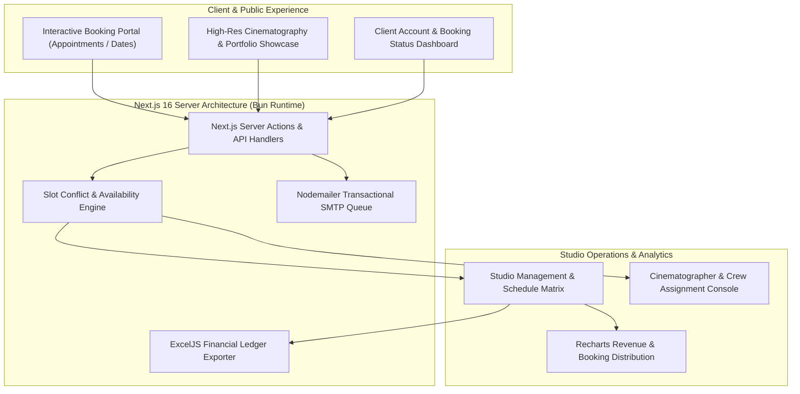

# 🎬 Muhammadi Studio — Event Booking & Media Pipeline Platform

<p align="center">
  
  
  
  
  
  
  
  
</p>
<br/>

> **Muhammadi Studio** is a high-performance cinematography, photography, and event management platform built on Next.js 16 and Bun. It features automated slot conflict resolution, multi-tier staff booking, automated Excel ledger generation, and transactional Gmail SMTP client notifications.

---

## 🏗️ System Architecture



---

## ⚡ Core Engineering Highlights

- **Bun-Powered Performance**: Fast builds, rapid server-side rendering, and low memory footprint utilizing Bun runtime dependencies and scripts.
- **Dynamic Scheduling & Conflict Guard**: Custom scheduling algorithms preventing double bookings across multi-day weddings, studio photo shoots, and cinematographer crews.
- **Automated Financial Reporting Pipeline**: Integrated `exceljs` pipeline compiling client invoices, advance deposits, remaining balances, and crew payouts into styled Excel spreadsheets.
- **Transactional SMTP Notification Engine**: Automated confirmation emails and schedule updates with branded HTML templates dispatched via Nodemailer.
- **Data-Dense Administration**: High-throughput admin tables powered by TanStack Table supporting column filtering, sorting, pagination, and status badge updates.

---

## 📁 Repository Structure

```text
app/
  (public)/             Public customer routes (Booking, Gallery, Cinematographers)
  account/              Client appointment management and profile settings
  api/                  Route handlers for bookings, contact forms, and Excel exports
lib/                    ExcelJS report builder, Nodemailer transport, and Zod schemas
```

---

## 🚀 Quick Start & Local Setup

### Prerequisites
- Bun >= 1.2.0 (or Node.js >= 20.0.0)

### 1. Installation
```bash
git clone https://github.com/DanishAjma1/muhammadi-studio.git
cd muhammadi-studio
bun install
```

### 2. Environment Configuration
Create a `.env` file in the root directory:
```env
SMTP_HOST="smtp.gmail.com"
SMTP_PORT=465
SMTP_USER="your-studio-email@gmail.com"
SMTP_PASS="your-app-specific-password"
NEXT_PUBLIC_BASE_URL="http://localhost:3000"
```

### 3. Run Development Server
```bash
bun run dev
```
Visit [http://localhost:3000](http://localhost:3000) to view the studio portal.

---

## 📜 License
Distributed under the MIT License. Built with passion by [Danish Ajmal](https://github.com/DanishAjma1).
